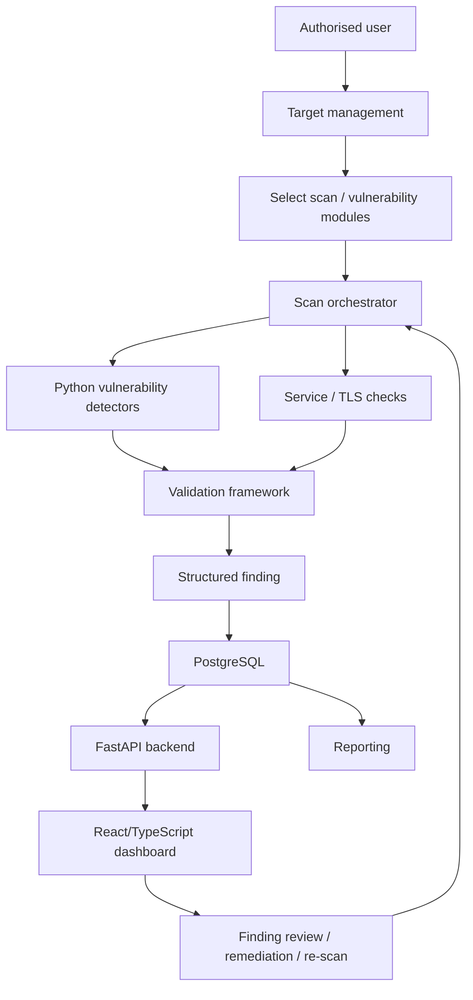

# VulnVista

> A controlled vulnerability-assessment platform for an isolated academic lab: a modular Python detection engine, FastAPI backend, PostgreSQL persistence, and a React/TypeScript dashboard covering fifteen vulnerability categories.

VulnVista detects, validates, stores, prioritises, and presents findings from intentionally vulnerable laboratory systems. It is being developed by **Group 7** for the **NIT6150 Advanced Project**. Unlike an orchestration layer around third-party scanners, each vulnerability category is checked by a purpose-built Python detector with its own safe test payload and validation logic — see [VulnVista_IMPLEMENTATION_PLAN.md](VulnVista_IMPLEMENTATION_PLAN.md) for the full eight-week roadmap and design detail.

> [!CAUTION]
> VulnVista is intended only for deliberately vulnerable applications in an isolated, pre-approved lab (DVWA, OWASP Juice Shop, Metasploitable2, a local TLS test service). Never use it to scan public, production, or third-party systems without explicit written authorization.

## Milestone tracker

Full per-vulnerability checklists live in the [implementation plan](VulnVista_IMPLEMENTATION_PLAN.md#8-eight-week-implementation-roadmap). Summary:

| Milestone | Target | Outcome | Status |
| --- | --- | --- | --- |
| M1 | Week 1 | Scope, architecture, and lab foundation | 🟡 Monorepo, backend/frontend scaffolding, and Docker Compose done; lab targets and safety controls next |
| V1–V3 + M2 | Week 2 | Core scan framework + SQL injection, command injection, XSS | ⬜ Not started |
| V4–V7 + M3A | Week 3 | + File upload, path traversal, CSRF, IDOR | ⬜ Not started |
| V8–V11 + M3 | Week 4 | + JWT/session, weak auth, SSRF, XXE; dashboard MVP | ⬜ Not started |
| V12–V15 + M4 | Week 5 | + Sensitive files, vulnerable services, misconfiguration, weak TLS — all 15 detectors, feature freeze | ⬜ Not started |
| M5A | Week 6 | Full integration, reporting, CI/CD | ⬜ Not started |
| M5 | Week 7 | Validated release candidate | ⬜ Not started |
| M6 | Week 8 | Final delivery, report, demonstration | ⬜ Not started |

## What VulnVista does

- Runs safe, repeatable detectors for fifteen vulnerability categories against approved lab targets only.
- Validates every finding (`NOT_DETECTED` → `SUSPECTED`/`CONFIRMED`/`INCONCLUSIVE`/`ERROR`) instead of reporting raw signals.
- Stores targets, scans, findings, and evidence in PostgreSQL behind a FastAPI backend.
- Maps findings to CWE, CVE, CVSS, and OWASP Top 10 categories where applicable.
- Presents severity, confidence, scan history, and remediation status on a React dashboard.
- Exports HTML/PDF reports from the same data shown on the dashboard.
- Isolates detector failures so one broken check never aborts a scan.

## High-level architecture



## Approved lab targets

| Target | Role | Setup |
| --- | --- | --- |
| DVWA | Adjustable-difficulty vulnerability exercises | [lab/docker-compose.yml](lab/docker-compose.yml) |
| OWASP Juice Shop | Modern Node.js app covering the OWASP Top 10 | [lab/docker-compose.yml](lab/docker-compose.yml) |
| Metasploitable2 | Known-vulnerable service catalogue | [lab/docker-compose.yml](lab/docker-compose.yml) (community image; VM alternative in [lab/METASPLOITABLE.md](lab/METASPLOITABLE.md)) |
| Local TLS test service | Weak TLS/certificate scenarios | Planned; see implementation plan §8, Week 1 |

All targets run on an isolated `vulnvista_net` Docker network with no route to production infrastructure. See [lab/README.md](lab/README.md) for URLs, default credentials, and safety controls.

## Vulnerability categories

| # | Category | # | Category |
| --- | --- | --- | --- |
| 1 | SQL Injection | 9 | Weak Authentication Controls |
| 2 | Command Injection | 10 | Server-Side Request Forgery (SSRF) |
| 3 | Cross-Site Scripting (XSS) | 11 | XML External Entity (XXE) |
| 4 | Unrestricted File Upload | 12 | Sensitive-File Exposure |
| 5 | Path Traversal / File Inclusion | 13 | Known Vulnerable Services |
| 6 | Cross-Site Request Forgery (CSRF) | 14 | Security Misconfiguration |
| 7 | Broken Access Control / IDOR | 15 | Weak TLS Configuration |
| 8 | Authentication / Session / JWT Weaknesses | | |

Every detector implements the same `BaseDetector` contract (`backend/app/scanners/base.py`): a safe `check()`, an optional `validate()`, and a `build_finding()` that maps onto the shared schema below.

## Implementation stack

| Layer | Technology |
| --- | --- |
| Backend | FastAPI, SQLAlchemy (async), Alembic, [uv](https://docs.astral.sh/uv/) |
| Storage | PostgreSQL, bind-mounted to the host so data survives container restarts |
| Frontend | React 19, TypeScript, Vite, Tailwind CSS v4, react-router |
| Detection engine | Python, one module per vulnerability category under `backend/app/scanners/` |
| Deployment | Docker Compose (root stack + separate `lab/` compose for vulnerable targets) |
| CI/CD | GitHub Actions — backend lint/test, frontend lint/build, Docker image builds |

## Shared finding schema

Every detector result maps onto the same `Finding` model (`backend/app/models/finding.py`):

```text
id, scan_id, target_id, detector_id
vulnerability_name, severity, confidence
validation_status   # NOT_DETECTED | SUSPECTED | CONFIRMED | INCONCLUSIVE | ERROR
finding_status       # OPEN | IN_PROGRESS | REMEDIATED | ACCEPTED_RISK | FALSE_POSITIVE
description, affected_endpoint, parameter, evidence_summary, remediation
cwe, cve, cvss_score, owasp_category
created_at
```

Evidence (HTTP request/response pairs, screenshots, TLS results, service banners, etc.) is stored separately per finding via the `Evidence` model, so a finding stays lightweight while still being fully reproducible.

## Dashboard views

- Severity, category, and target distribution.
- Findings table with filtering by target, severity, confidence, and validation status.
- Finding detail: evidence, CWE/CVE/CVSS/OWASP mapping, remediation guidance.
- Scan history with new/recurring/remediated comparisons across repeated scans.
- Remediation status tracking and HTML/PDF report export.

## Quality and safety checklist

- Detectors run only against the approved target allowlist — no arbitrary public hosts.
- Only synthetic accounts, files, and data are used or seeded.
- No destructive payloads, no denial-of-service, no automatic exploitation for system control.
- A detector failure never aborts the rest of a scan.
- Every finding retains a detector ID, scan ID, and evidence for reproducibility.
- The environment runs reproducibly with Docker Compose; secrets stay out of Git.

Full checklist: [implementation plan §18](VulnVista_IMPLEMENTATION_PLAN.md#18-security-and-ethical-controls-checklist).

## Standards and methodology

| Area | Standard | Project use |
| --- | --- | --- |
| Vulnerability classes | OWASP Top 10 | Structures the detector catalogue and dashboard categories |
| Weakness classification | CWE | Attached to each finding where applicable |
| Known-vulnerability tracking | CVE | Attached to vulnerable-service findings |
| Technical severity | CVSS v3.1 | Consistent severity baseline where a score applies |

## Definition of done

Full checklist: [implementation plan §20](VulnVista_IMPLEMENTATION_PLAN.md#20-final-definition-of-project-done). Summary — the project is complete when:

- [ ] All four approved lab targets are reachable in the isolated lab.
- [ ] All fifteen detectors work and share a common schema.
- [ ] Findings, evidence, severity, and confidence persist in PostgreSQL.
- [ ] The dashboard presents findings, scan history, and remediation status.
- [ ] Report export, Docker deployment, and CI/CD all work.
- [ ] Evaluation metrics (detection rate, false-positive/negative rate, repeatability) are calculated.
- [ ] Documentation, academic report, and final demonstration are complete.

## Team workflow

1. Create a branch for each issue or milestone task.
2. Keep commits focused and reference the related requirement or checklist item.
3. Require another team member to review detector, schema, and safety-control changes.
4. Do not commit real credentials, `.env` files, or generated evidence containing sensitive data.
5. Update this README's milestone table as milestones are reviewed and accepted.

## Project status

**Current phase:** Week 1 — project foundation (monorepo, backend/frontend scaffolding, and Docker Compose persistence are in place; lab target deployment and the first detectors are next).
**Overall progress:** M1 in progress, 0/15 detectors implemented.

## Monorepo quickstart

The repository is structured as a monorepo: [backend/](backend/) (FastAPI + PostgreSQL),
[frontend/](frontend/) (React/TypeScript), [lab/](lab/) (vulnerable scan targets), plus
`docs/`, `scripts/`, and `.github/workflows/`. See
[VulnVista_IMPLEMENTATION_PLAN.md](VulnVista_IMPLEMENTATION_PLAN.md) for the full
architecture and roadmap.

### Prerequisites

- Docker and Docker Compose v2
- (Optional, for running outside Docker) [uv](https://docs.astral.sh/uv/) for the
  backend and Node.js 20+ for the frontend

### First run

```bash
./scripts/setup.sh        # creates ./storage, copies .env.example -> .env, creates the shared network
docker compose up --build # starts postgres + backend + frontend
```

- Backend API: <http://localhost:8000/api/health>
- Frontend dashboard: <http://localhost:5173>

### Persistent data

All state lives on the host under `./storage/` (git-ignored), bind-mounted into the
containers — **not** inside a container's writable layer or an opaque Docker-managed
volume:

- `./storage/postgres` — the PostgreSQL data directory
- `./storage/uploads` — backend-collected scan evidence / uploaded files
- `./storage/lab/juice-shop` — OWASP Juice Shop challenge/user state

`docker compose down`, a host reboot, or `docker compose up` again all leave this data
untouched. Only `docker compose down -v` or manually deleting `./storage` removes it.

### Lab targets

DVWA and OWASP Juice Shop run from a separate compose file so the core app stack stays
fast and independent of them. Both compose files attach to the shared `vulnvista_net`
network as external, so run `./scripts/setup.sh` once first (it creates the network)
before starting either one:

```bash
docker compose --env-file .env -f lab/docker-compose.yml up -d
```

See [lab/README.md](lab/README.md) for target URLs/credentials and
[lab/METASPLOITABLE.md](lab/METASPLOITABLE.md) for running Metasploitable2 as a VM
(it has no official Docker image).

---

VulnVista is an academic defensive-security project. All testing must remain authorized, isolated, contained, and reproducible.
