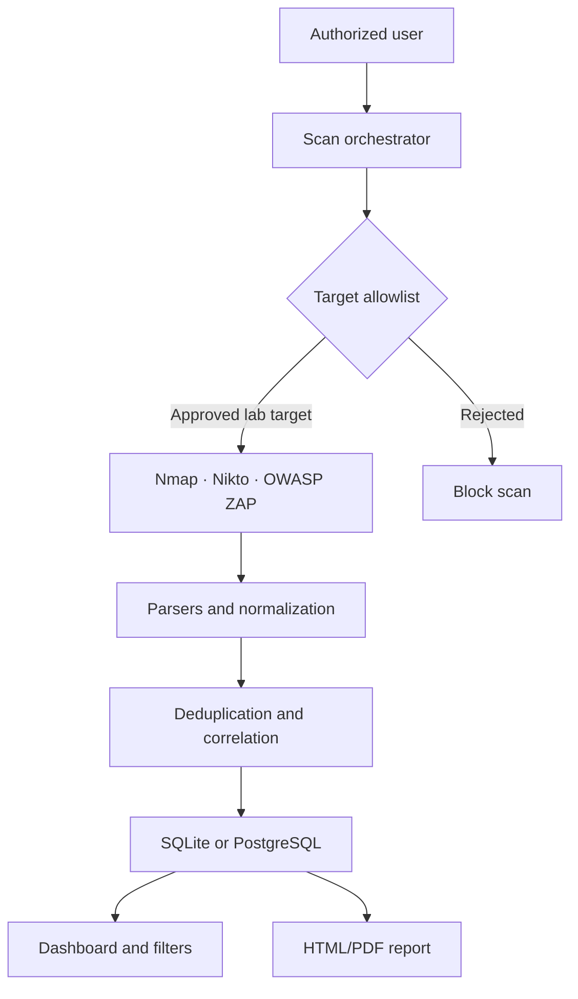

# VulnVista

> A standards-aligned penetration-testing and security-visualization platform for an isolated academic lab.

VulnVista combines repeatable web application penetration testing with a dashboard that converts Nmap, Nikto, and OWASP ZAP results into clear security-posture insights. The project is being developed by **Group 7** for the **NIT6150 Advanced Project**.

> [!CAUTION]
> VulnVista is intended only for deliberately vulnerable applications in an isolated, pre-approved lab. Never use it to scan public, production, or third-party systems without explicit written authorization.

## Milestone tracker

- [ ] **M1 — Scoping signed off (end of Week 2)**
  - [ ] Select the deliberately vulnerable target application.
  - [ ] Deploy the target in an isolated Docker or host-only network.
  - [ ] Document the application architecture, data flows, hosts, ports, and services.
  - [ ] Define in-scope and out-of-scope assets.
  - [ ] Agree on test windows, escalation contacts, and rules of engagement.
  - [ ] Complete and present the Scoping Assessment Document.

- [ ] **M2 — Test plan approved (end of Week 4)**
  - [ ] Map test scenarios to the OWASP Top 10 and WSTG checklist.
  - [ ] Reference NIST SP 800-115, PTES, and MITRE ATT&CK where applicable.
  - [ ] Define the method, tool, and pass/fail criteria for every test scenario.
  - [ ] Review the safety controls and target allowlist.
  - [ ] Complete and present the Penetration Testing Plan.

- [ ] **M3 — Draft report validated (end of Week 7)**
  - [ ] Execute Nmap, Nikto, and OWASP ZAP scans.
  - [ ] Normalize and correlate results in the shared schema.
  - [ ] Compile the draft penetration-testing report.
  - [ ] Reproduce each reported finding.
  - [ ] Review findings with the tool owner.
  - [ ] Record validation notes and remove or mark false positives.

- [ ] **M4 — Final delivery (end of Week 8)**
  - [ ] Assign CVSS v3.1 scores and Likelihood × Impact ratings.
  - [ ] Add remediation recommendations to every validated finding.
  - [ ] Complete dashboard integration and report export.
  - [ ] Verify that dashboard and report data remain consistent.
  - [ ] Complete the final penetration-testing report.
  - [ ] Deliver the final presentation and live demonstration.

## Project outcomes

VulnVista has two integrated outputs:

1. A repeatable penetration-testing process covering scoping, planning, execution, validation, risk assessment, and reporting.
2. A dashboard that presents normalized scan results by severity, host, vulnerability class, exposed service, remediation status, and time.

## Objectives

- Establish a safe, legal, and reproducible vulnerable web application lab.
- Create a test plan mapped to OWASP guidance and recognized penetration-testing methodologies.
- Orchestrate Nmap, Nikto, and OWASP ZAP scans.
- Normalize different tool outputs into one traceable data model.
- Deduplicate correlated findings and reduce false positives.
- Score validated findings with CVSS v3.1 and a qualitative risk matrix.
- Present actionable findings through an accessible dashboard.
- Generate an HTML/PDF report from the same data used by the dashboard.

## High-level architecture



## Target environment

The selected target must run locally with synthetic data and no route to production infrastructure.

| Candidate | Strengths | Example synthetic data |
| --- | --- | --- |
| OWASP Juice Shop | Modern Node.js application covering the OWASP Top 10; built-in challenge engine | Accounts, orders, payment records, admin credentials |
| OWASP DVWA | Adjustable difficulty and focused vulnerability exercises | User records, password hashes, session cookies |
| bWAPP | Broad catalogue of vulnerability classes | Credentials and simulated financial records |

### Target selection checklist

- [ ] Confirm the target application's license and local deployment method.
- [ ] Seed only fake credentials and PII-like records.
- [ ] Configure an isolated Docker or host-only network.
- [ ] Deny arbitrary external scan targets.
- [ ] Record the approved hostname, IP range, ports, and application URL.
- [ ] Test the containment control before enabling active scans.

## Core tools

| Tool | Role | Data used by VulnVista |
| --- | --- | --- |
| Nmap | Host, port, service, version, and OS discovery | Asset and exposed-service inventory |
| Nikto | Web-server configuration and component checks | Misconfiguration and outdated-component findings |
| OWASP ZAP | Spidering, passive/active DAST, and proxy-assisted testing | Application alerts, URLs, parameters, evidence, and severity |

## Suggested implementation stack

| Layer | Suggested option | Notes |
| --- | --- | --- |
| Storage | SQLite or PostgreSQL | SQLite is sufficient for the contained prototype; PostgreSQL supports a larger multi-user deployment. |
| Orchestration and ingestion | Python | Use one adapter/parser per scanner and ZAP's REST API where practical. |
| Dashboard | Streamlit + Plotly, or React | Streamlit is faster to prototype; React provides greater interface flexibility. |
| Report generation | Templated HTML to PDF | Generate reports from the same stored findings displayed by the dashboard. |
| Deployment | Docker Compose | Reproduces the lab, application services, and dashboard across team machines. |

## Shared finding schema

Define the shared model before building charts. A finding should retain at least:

```text
finding_id
scan_id
source_tool
host
port
service
affected_url
vulnerability_name
CVE_id
CWE_id
OWASP_category
CVSS_vector
CVSS_score
severity
likelihood
impact
status
evidence
validation_notes
first_seen
last_seen
```

Recommended remediation states are `Open`, `In Progress`, `Remediated`, `Accepted Risk`, and `False Positive`. Correlate possible duplicates using host, port, and CWE/CVE identifiers while retaining each source tool for auditability.

## Feature checklist

### Must have

- [ ] Save an allowlisted lab scan target.
- [ ] Run Nmap and capture ports, services, and versions.
- [ ] Run Nikto and capture server findings.
- [ ] Run OWASP ZAP spider and active scans and capture alerts.
- [ ] Parse Nmap XML, Nikto XML/CSV, and ZAP JSON into the shared schema.
- [ ] Persist scan metadata and normalized findings.
- [ ] Show severity distribution.
- [ ] Show vulnerabilities per host and common vulnerability types.
- [ ] Show open ports and services.
- [ ] Compare two or more scans over time.
- [ ] Export an HTML/PDF report from the stored data.

### Should have

- [ ] Deduplicate or correlate findings reported by multiple scanners.
- [ ] Map findings to CWE and OWASP Top 10 categories.
- [ ] Track remediation status.
- [ ] Display a Likelihood × Impact risk matrix.
- [ ] Filter by host, severity, scanner, status, and OWASP category.
- [ ] Calculate finding age and mean time to remediate.

### Could have

- [ ] Allow reviewer annotations and tool-owner validation notes.
- [ ] Add simple authentication for authorized project users.

## Dashboard views

- [ ] Security summary with total and new findings.
- [ ] Critical/High/Medium/Low severity distribution.
- [ ] Findings grouped by host and affected service.
- [ ] Most common CWE and OWASP categories.
- [ ] Open ports and detected services inventory.
- [ ] New, recurring, and remediated findings over time.
- [ ] Finding status and closure-rate view.
- [ ] Finding age and mean-time-to-remediate metrics.
- [ ] 5 × 5 Likelihood × Impact risk matrix.
- [ ] Finding detail view with evidence, sources, and remediation guidance.

## Quality and safety checklist

- [ ] Scans are restricted to the approved isolated network range.
- [ ] Only synthetic test data is processed or displayed.
- [ ] A full three-tool scan completes within the agreed demo window (target: 30 minutes or less).
- [ ] Failure or timeout of one scanner does not discard other scanner results.
- [ ] Dashboard and exported reports use the same underlying records.
- [ ] Scanner parsers are modular and independently testable.
- [ ] The environment runs reproducibly with Docker Compose.
- [ ] Every finding retains a source tool, scan ID, and timestamp.
- [ ] CVSS v3.1 is used consistently for technical severity.
- [ ] Dashboard terminology is understandable to a non-technical stakeholder.

## Eight-week delivery plan

| Week | Penetration-testing track | Dashboard/tool track | Exit check |
| --- | --- | --- | --- |
| 1–2 | Environment setup, target deployment, and scoping | Initial repository and lab setup | [ ] M1 signed off |
| 2–3 | Finalize scope inputs | Schema design and Docker Compose setup | [ ] Schema reviewed |
| 3–4 | Test-plan development and OWASP/TTP mapping | Parser contracts and sample-output collection | [ ] M2 approved |
| 4–5 | Prepare controlled scan scenarios | Build Nmap, Nikto, and ZAP ingestion | [ ] All parsers tested |
| 5–6 | Execute scans and collect evidence | Build core dashboard views | [ ] Results visible end-to-end |
| 7 | Compile and validate the draft report | Add trends, risk matrix, and report export | [ ] M3 validated |
| 8 | Risk assessment, remediation, and final report | Final integration and demo preparation | [ ] M4 delivered |

## Standards and methodology

| Area | Standard or framework | Project use |
| --- | --- | --- |
| Vulnerability classes | OWASP Top 10 | Structures the scenario catalogue and dashboard categories |
| Test methodology | OWASP Web Security Testing Guide | Provides test cases and validation guidance |
| Engagement lifecycle | NIST SP 800-115 | Guides planning, discovery, testing, and reporting |
| Technique framing | MITRE ATT&CK | Describes relevant attacker tactics and techniques |
| Engagement structure | PTES | Cross-checks scoping, execution, and reporting |
| Technical severity | CVSS v3.1 | Provides a consistent severity baseline |
| Business risk | OWASP Risk Rating Methodology | Converts likelihood and impact into risk tiers |

## Definition of done

The project is complete when:

- [ ] All four formal milestones are signed off.
- [ ] A scan can run end-to-end against only the approved isolated target.
- [ ] Results from all three scanners are normalized, traceable, and displayed.
- [ ] Findings can be validated, rated, filtered, and assigned a remediation state.
- [ ] Repeated scans produce meaningful trend and closure information.
- [ ] The exported final report matches the dashboard data.
- [ ] The final demonstration is reproducible on a clean team machine.
- [ ] The final report includes risk ratings, evidence, and remediation guidance.

## Team workflow

1. Create a branch for each issue or milestone task.
2. Keep commits focused and reference the related requirement or checklist item.
3. Require another team member to review scanner, schema, and safety-control changes.
4. Do not commit real credentials, scan secrets, real personal data, or generated raw reports containing sensitive information.
5. Update this README's checkboxes when deliverables are reviewed and accepted.

## Project status

**Current phase:** Planning and environment selection  
**Overall progress:** `0/4` milestones complete

---

VulnVista is an academic defensive-security project. All testing must remain authorized, isolated, contained, and reproducible.
