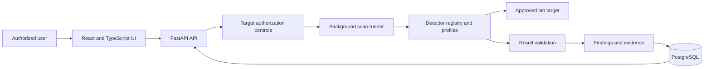

# VulnVista

VulnVista is a controlled vulnerability-assessment platform for an isolated academic laboratory. It combines purpose-built Python detectors, a FastAPI API, PostgreSQL persistence, and a React/TypeScript interface for registering approved targets, running scans, reviewing findings, and inspecting evidence.

The project is being developed by **Group 7** for the **NIT6150 Advanced Project**. The longer-term design and academic roadmap are in [VulnVista_IMPLEMENTATION_PLAN.md](VulnVista_IMPLEMENTATION_PLAN.md).

> [!CAUTION]
> VulnVista must only be used against deliberately vulnerable systems or targets for which the operator has explicit authorization. Do not scan public, production, or third-party systems without written permission.

## Current implementation status

This table describes the code currently present in the project rather than the original project plan.

| Area | Status | Current capability |
| --- | --- | --- |
| Target management | Implemented | Register and list targets, record authorization, approve bundled lab hosts, and block cloud metadata endpoints |
| Scan orchestration | Implemented | Queue background scans, run a detector profile, isolate detector failures, and record status and duration |
| Detector engine | In progress | Ten detector modules are registered; nine currently have API-selectable scan profiles |
| Findings and evidence | Implemented | Persist reportable findings and detector evidence, filter findings, and update remediation status |
| Frontend dashboard | Implemented | Security posture, severity distribution, scan outcomes, detector coverage, OWASP mapping, and highest-risk findings |
| Targets, scans, and findings UI | Implemented/in integration | Create and browse targets and scans, inspect scan results, and review findings |
| Authentication and roles | Integration in progress | Login, protected routes, and user-management code is being integrated; supporting auth modules must be completed before use |
| Evidence workspace | Integration in progress | A dedicated evidence-review page is being integrated |
| Report export | Planned | HTML/PDF export is not implemented yet |

## Features

### Security dashboard

The frontend index page presents a live overview using targets, scans, and findings returned by the API. It includes:

- Total open findings and registered targets.
- Open critical findings requiring immediate attention.
- Confirmed and suspected validation results.
- Scan completion rate and seven-day scan outcomes.
- Open-finding distribution by severity.
- Coverage across the planned detector catalogue.
- Open findings grouped by OWASP category.
- A prioritized list of the highest-risk open findings using severity and CVSS.
- Links from summaries to detailed scans and findings.
- Loading, API error, and retry states.

### Target management and safety controls

Targets are stored with a name, type, URL or address, environment, optional scan configuration, and authorization state.

- Bundled laboratory hostnames are automatically approved.
- Other targets require an explicit authorization acknowledgement when registered.
- Cloud metadata endpoints such as `169.254.169.254` are always blocked.
- A scan cannot start unless its target is approved.
- Approval is calculated by the backend and cannot be supplied directly by a client.

The trusted and blocked hostname lists are configurable through `LAB_ALLOWED_HOSTS` and `BLOCKED_HOSTS`.

### Scan lifecycle

When a scan is created, the backend performs this workflow:

1. Confirms that the target exists and is approved.
2. Creates a scan with the `QUEUED` status.
3. Starts the scan runner as a FastAPI background task.
4. Changes the scan to `RUNNING` and resolves the selected profile.
5. Executes each detector and validates its result.
6. Persists `CONFIRMED`, `SUSPECTED`, and `INCONCLUSIVE` results as findings.
7. Stores detector evidence in a separate record linked to the finding.
8. Marks the scan `COMPLETED`, `PARTIAL`, or `FAILED` and records duration and errors.

A detector exception is caught independently, so one faulty detector does not automatically terminate the rest of the scan.

### Vulnerability detectors

Each detector extends the common `BaseDetector` contract and supplies a `check()`, optional validation, and finding construction.

| Detector | Profile key | Availability |
| --- | --- | --- |
| Command injection | `command_injection` | Selectable |
| SQL injection | `sqli_detector` | Selectable |
| Weak authentication | `weak_auth` | Selectable |
| Sensitive-file exposure | `sensitive_files` | Selectable |
| Known vulnerable services | `vulnerable_services` | Selectable |
| Weak TLS configuration | `weak_tls` | Selectable |
| Cross-site scripting | `xss` | Selectable |
| XML external entity injection | `xxe` | Selectable |
| Broken access control / IDOR | `idor` | Selectable |
| Server-side request forgery | `ssrf` | Registered; scan-profile mapping still required |

The remaining planned categories are unrestricted file upload, path traversal/file inclusion, CSRF, authentication/session/JWT weaknesses, and general security misconfiguration.

### Findings and evidence

Detector output is normalized into a shared finding structure:

```text
id, scan_id, target_id, detector_id
vulnerability_name, severity, confidence
validation_status, finding_status
description, affected_endpoint, parameter
evidence_summary, remediation
cwe, cve, cvss_score, owasp_category
created_at
```

Validation status describes the technical conclusion:

- `NOT_DETECTED`
- `SUSPECTED`
- `CONFIRMED`
- `INCONCLUSIVE`
- `ERROR`

Finding status tracks review and remediation:

- `OPEN`
- `IN_PROGRESS`
- `REMEDIATED`
- `ACCEPTED_RISK`
- `FALSE_POSITIVE`

Evidence is stored separately and linked to its finding. This keeps the finding concise while retaining detector probe data for review and reproducibility.

### API capabilities

All application routes are mounted below `/api`.

| Method | Endpoint | Purpose |
| --- | --- | --- |
| `GET` | `/health` | Check backend and environment health |
| `POST` | `/targets` | Register a target and calculate its approval state |
| `GET` | `/targets` | List targets |
| `GET` | `/targets/{target_id}` | Get one target |
| `POST` | `/scans` | Queue a scan for an approved target |
| `GET` | `/scans` | List scans, newest first |
| `GET` | `/scans/{scan_id}` | Poll scan state and metadata |
| `GET` | `/scans/{scan_id}/findings` | Retrieve findings produced by a scan |
| `GET` | `/findings` | List findings, optionally filtered by target, severity, or validation status |
| `GET` | `/findings/{finding_id}` | Retrieve a finding with its evidence |
| `PATCH` | `/findings/{finding_id}/status` | Update remediation status |

Authentication endpoints under `/api/auth` are being integrated and should not be treated as complete until their supporting security, user-model, schema, dependency, migration, and frontend auth modules are present and tested.

## Typical user workflow

1. Start the VulnVista core stack and isolated lab targets.
2. Open the frontend dashboard.
3. Register a bundled lab target or confirm authorization for another controlled target.
4. Choose the approved target and a detector profile on the scans page.
5. Start the scan and monitor its status.
6. Review findings, severity, confidence, standards mappings, remediation, and evidence.
7. Update each finding as it is investigated or remediated.
8. Re-scan and compare the current security posture on the dashboard.

## Architecture



## Technology stack

| Layer | Technology |
| --- | --- |
| Backend | Python, FastAPI, SQLAlchemy async, Alembic, uv |
| Database | PostgreSQL 16 |
| Frontend | React 19, TypeScript, Vite, Tailwind CSS v4, React Router |
| Detection | Purpose-built asynchronous Python detector modules |
| Lab | DVWA, OWASP Juice Shop, Metasploitable2, and a local TLS test service |
| Deployment | Docker Compose with persistent host-mounted storage |

## Repository structure

```text
backend/
  app/api/          REST endpoints and dependencies
  app/models/       SQLAlchemy database models
  app/scanners/     detector implementations and registry
  app/schemas/      API request and response schemas
  app/services/     scan runner and supporting services
  tests/            backend tests
frontend/
  src/components/   shared interface components
  src/pages/        dashboard and workflow pages
  src/services/     API client
  src/types/        shared frontend types
lab/                isolated vulnerable targets
scripts/            setup and support scripts
storage/            persistent runtime data, ignored by Git
```

## Quickstart

### Prerequisites

- Docker and Docker Compose v2
- Optional local tools: [uv](https://docs.astral.sh/uv/) and Node.js 20+

### Start the application

```bash
./scripts/setup.sh
docker compose up --build
```

Services:

- Frontend: <http://localhost:5173>
- Backend health: <http://localhost:8000/api/health>
- FastAPI documentation: <http://localhost:8000/docs>
- pgAdmin: <http://localhost:5050>

The setup script prepares storage, creates `.env` from `.env.example` when necessary, and creates the shared `vulnvista_net` network.

### Start the lab targets

```bash
docker compose --env-file .env -f lab/docker-compose.yml up -d
```

See [lab/README.md](lab/README.md) for URLs and credentials, and [lab/METASPLOITABLE.md](lab/METASPLOITABLE.md) for the Metasploitable2 VM option.

### Persistent data

Runtime data is stored on the host so it survives container restarts:

- `storage/postgres` contains PostgreSQL data.
- `storage/uploads` contains backend evidence and uploaded artifacts.
- `storage/lab/juice-shop` contains Juice Shop state.

`docker compose down` does not remove these directories. Deleting `storage/` removes persisted local state and should only be done intentionally.

## Development and verification

```bash
# Backend tests
docker compose exec backend pytest

# Frontend checks
docker compose exec frontend npm run lint
docker compose exec frontend npm run build
```

Current backend tests cover health, target allowlisting, and several detector implementations. New detectors and workflow changes should include focused tests before integration.

## Safety principles

- Scan only systems that are isolated and explicitly authorized.
- Use synthetic users, files, and data.
- Do not introduce destructive payloads, denial-of-service behavior, or automated takeover.
- Keep real credentials, `.env` files, and sensitive evidence out of Git.
- Retain scan IDs, detector IDs, validation results, and evidence for reproducibility.
- Treat detector failures independently and expose them through scan status.

## Planned work

- Complete and test authentication, authorization, and user management.
- Finish integration of the evidence workspace.
- Add the SSRF scan profile and test it through the API workflow.
- Implement the remaining five planned detector categories.
- Add repeat-scan comparison and new/recurring/remediated classification.
- Add HTML/PDF report export.
- Expand frontend, API, integration, and end-to-end tests.
- Complete CI/CD and release documentation.

## Team workflow

1. Create a focused branch for each feature or issue.
2. Keep commits limited to one coherent change.
3. Review detector, schema, authorization, and safety-control changes before merging.
4. Run relevant tests and builds before opening a pull request.
5. Update this README when feature availability changes.

---

VulnVista is an academic defensive-security project. All testing must remain authorized, isolated, contained, and reproducible.
